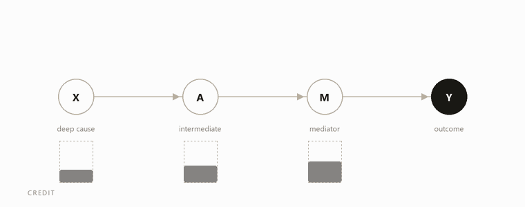
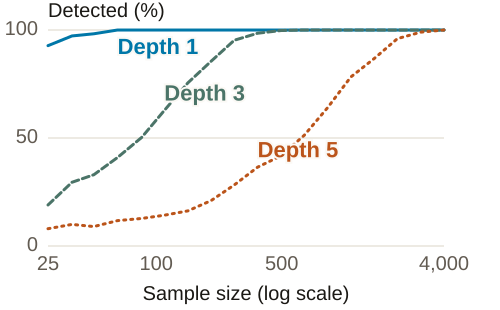

# Causal SHAP: a benchmark using a spaceflight risk graph

[](https://github.com/ahhatype/causal-shap-spaceflight-renal-stones/actions/workflows/python-tests.yml)
[Supplementary Information](docs/playbook/supplementary-information/main.pdf) · [Reproducibility guide](docs/REPRODUCIBILITY.md) · [Technical notes](docs/technical/path-length-and-response-shape.md)

A prediction ranking explains a fitted model. To assess what would happen
after changing a variable, we also need assumptions about the causal
relationships. This study compares those answers using synthetic data based
on NASA's renal-stone graph, with numerical mechanisms chosen by the study team.

<p align="center"></p>

With full mediation and exact measurement, an ideal predictor can use M
alone even though changing X affects Y through A and M. The bars illustrate
this distinction; they are not fitted SHAP values or effect sizes, and
their totals are not comparable across phases.

## The central workflow

The manuscript and explanatory supplement use the same Steps 0–6. The question
selects the prediction or causal route; discovery and attribution are optional
when the target does not require them.

| Step | Operation |
| --- | --- |
| 0. Define the question and target population | Prediction, an intervention contrast or allocation; specify population and timing. |
| 1. Prepare the data and predictive reference | Declared data or simulation, fitted predictor and ordinary SHAP comparator. |
| 2. Discover candidate causal structure (optional) | PC or a justified alternative; a supplied graph bypasses discovery. |
| 3. Review the graph and specify required mechanisms | Document evidence and revisions; retain uncertainty and identify required mechanisms. |
| 4. Define interventions and construct the causal game | State the target, intervention values, background and scale; do-surgery where applicable. |
| 5. Calculate causal attributions | Apply the selected allocation rule and state the causal information supplied. |
| 6. Evaluate results under the relevant data conditions | Assess the declared targets; rerun relevant steps when data conditions change. |

The [Supplementary Information](docs/playbook/supplementary-information/main.pdf)
([editable source](docs/playbook/supplementary-information/README.md)) develops
these choices. The [workflow and evidence map](docs/playbook/central-workflow.md)
records which components have been evaluated. The systematic comparison under
changing data conditions remains proposed.

## Worked example and simulation

Consider M = 0.6X + eM and Y = 0.6M + eY, with independent mean-zero
disturbances, x = 1 and eM = 0.2. The ideal predictor is f = 0.6M.

| Quantity | X | M | What it answers |
| --- | ---: | ---: | --- |
| Predictive model-interventional Shapley credit | 0 | 0.48 | Which inputs contribute to this prediction? |
| Symmetric structural Shapley credit | 0.18 | 0.30 | How does a specified causal game distribute credit? |
| Mean effect of setting X from 0 to 1 | 0.36 | — | How much does the expected outcome change? |

Both credit allocations sum to the prediction relative to a zero background.
The intervention contrast is a different quantity. The [do-Shapley tutorial](docs/technical/do-shapley.md),
based on Jung et al. (2022) and Heskes et al. (2020),
defines the games and derives the numbers. This is an exact teaching example,
separate from the renal simulations and their attribution methods.

The renal simulations add competing predictors, multiple pathways, an
interaction and a binary outcome. The supplied NASA graph has 53 nodes and
83 edges. Existing full-DAG simulations use an earlier 51-node source version;
the 14-node working model adds variables and modifies pathways. Numerical
mechanisms are study assumptions. The [graph provenance and edge crosswalk](docs/technical/graph-provenance.md)
show what each version retains and changes.

| Testbed | Finding | Evidence and limits |
| --- | --- | --- |
| Five-node teaching stress test | An outcome descendant receives 45.6% of ordinary SHAP mass despite zero total effect. | Deliberately constructed teaching case, separate from the renal simulations. [Record](docs/full_dag/RESEARCH_RECORD.md). |
| 14-node working subgraph | Credit shifts in both directions by chain and model. Gaussian PC isolates the binary outcome at n = 1,000. | One seed. Scripted revisions produce mixed changes across methods; no human reviewed the rounds. [Baseline results](docs/step04_results.md), [scripted revisions](docs/step06_results.md). |
| 51-node source DAG | Ordinary versus ordering-only Kendall's tau: 0.506 / 0.528, with no detected difference. A propagation prototype reaches 0.794. | The prototype receives known mechanisms and uses a different budget, without repeated-seed uncertainty; its score does not establish method superiority. [Research record](docs/full_dag/RESEARCH_RECORD.md). |

Kendall's tau measures agreement with individual intervention-effect rankings,
which is separate from estimating a causal allocation accurately. The
two renal graphs use separate generators and intervention ranges, so their
scores are not one head-to-head comparison. See [comparison inputs and intervention definitions](docs/playbook/central-workflow.md#what-information-each-comparison-receives).

## Path length and response shape



In a chain with coefficient 0.6 on every edge, longer paths transmit smaller
effects, making marginal slopes harder to detect. This is a teaching
experiment, not a measure of graph-discovery accuracy. Greater path length
does not always mean a smaller effect, and a direct arrow need not describe
a straight-line response.

The [technical note](docs/technical/path-length-and-response-shape.md) gives
the derivations, detection rule, nonlinear examples and spline context,
with [BibTeX references](docs/references/technical-companion.bib).
Nonlinear robustness of the renal comparisons remains pending.

## Teaching materials

The [teaching companion](docs/classroom/README.md) includes an interactive
calculation, [student worksheet](docs/classroom/worksheet.md),
[educator guide and answer key](docs/classroom/educator-guide.md), and a
Python lab requiring no additional packages. It supports a 50-minute lesson
or a 90-minute lab.

Download and extract the repository, then open `docs/classroom/index.html`.
To check the calculations:

```bash
python docs/classroom/lab.py --check
```

## Quickstart

For the research code, create a Python 3.13 environment:

```bash
py -3.13 -m venv .venv
.venv/Scripts/python -m pip install -e ".[discovery,workbench,dev]"
.venv/Scripts/python -m pytest
```

On macOS or Linux use `python3.13` and `.venv/bin/python`.
The [reproducibility guide](docs/REPRODUCIBILITY.md) covers the R pipelines,
frozen-output validation, depth experiment and downloadable teaching kit.
The [research apps](apps/README.md) provide interactive exploration.

## Protocol

The [Implementation crosswalk](docs/playbook/protocol.md) lists implementation paths
and completion status. The [documentation index](docs/README.md) covers
methods, results, references and provenance; the [repository map](#repository-map)
below locates the source files.

## Experiments

Exploratory and team work that is not part of the frozen result records lives
under [`experiments/`](experiments/README.md), one folder per experiment with
its own README. The first entry is the stand-alone
[ConfoundingSHAP tutorial](experiments/confoundingshap-tutorial/README.md).
Earlier pilots that already live under `analysis/` are indexed there as well.

## Repository map

```
config/           DAG spec, edge coefficients, model engines, pipeline status (YAML)
pipeline/         Numbered driver scripts for the 14-node working subgraph, one per step
r/                R package for the working subgraph (renv): DAG utilities,
                  simcausal helpers, ground truth, pcalg and shapr wrappers
python/src/       causal_shap_renal: attribution methods, discovery wrappers,
                  evaluation, the file interchange contract, the LumaWarp contract
python/tests/     pytest suite for causal_shap_renal
data/             frozen_truth (committed); raw, interim and simulated are regenerated
results/          attributions, discovery, evaluation, figures; detector/ (gitignored)
analysis/         R pipeline on the full 51-node source DAG, its frozen result record
                  under analysis/output/, and the ConfoundingSHAP pilots
apps/             causal_shap library (teaching DAGs, discovery, structural value
                  function, validation, M1-M5, action selection, figures); the guided
                  hub, the M1-M5 Workbench and the six-rung ladder app; frozen bundles; tests
experiments/      Team sandbox: self-contained experiments outside the frozen records
references/       NASA SA-07566 DAGitty text; Robert Reynolds's 2026-07-13 files
dag-candidates/   Core-graph node and edge CSVs, harvest notes, provisional edge lists
docs/             Playbook, technical notes, classroom, references, decisions (ADRs),
                  step results, full-DAG record, reproducibility guide. Index: docs/README.md
site/             Archived presentations and assets (ADR 010); not deployed
manuscript/       Private article source and coauthor review notes (gitignored, ADR 009)
```

## Related repositories

| Repository | Role |
| --- | --- |
| [ahhatype/causal-dag-eval-pipeline](https://github.com/ahhatype/causal-dag-eval-pipeline) | The manuscript's central experiment: replicated simcausal data from the adapted SA-07566 graph, shape validation and attribution validation. Being prepared as the public-facing version shared with the manuscript. |
| This repository | Team workspace and sandbox: the earlier lines of work, frozen records, apps, teaching materials and experiments. |
| [andystats/causal-shap-target-dags](https://github.com/andystats/causal-shap-target-dags) | Archived on 2026-10-10. Its tracked content was ported here in September 2026 ([ADR 007](docs/decisions/007-target-dags-consolidation.md)); the retirement is recorded in [ADR 011](docs/decisions/011-archive-target-dags-and-experiments.md). |

## License

[GPL-3.0-or-later](LICENSE). See [code provenance and notices](docs/provenance.md#code-provenance-and-third-party-notices)
for the origin of the ported code. External source material retains its original terms.
